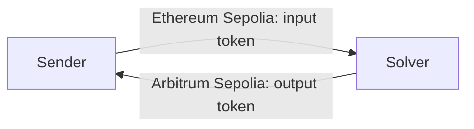

# Cross-Chain Intent Router

A user signs an intent to swap an ERC-20 token on one chain for an ERC-20 token on another. A solver bot fills that intent: it pays the recipient on the destination chain, then collects the input tokens from the sender on the source chain.

This repository is a testnet implementation. It uses Ethereum Sepolia and Arbitrum Sepolia. No mainnet funds are required.

## Flow

1. The sender connects a wallet and signs an EIP-712 intent.
2. The backend checks that signature and stores the intent.
3. The solver bot pays the output tokens to the recipient on Arbitrum Sepolia.
4. The solver bot then pulls the input tokens from the sender on Ethereum Sepolia.
5. The intent is marked completed.

The sender approves `IntentRegistry` to spend the input token. The solver approves `TargetEscrow` to spend the output token. Native ETH is used only for gas.



In the local demo the same wallet can be both sender and recipient. The solver is a different wallet, and that wallet must hold the output token on Arbitrum Sepolia before it can fill an intent.

## Contracts

| Contract | Chain | Role |
| --- | --- | --- |
| `IntentRegistry` | Ethereum Sepolia (11155111) | Verifies the signature and transfers the input token from the sender to the solver |
| `TargetEscrow` | Arbitrum Sepolia (421614) | Transfers the output token from the solver to the recipient |

`IntentRegistry` is deployed at `0xF1A60d867fa022d65546e390A633901c5f34617A`.

`TargetEscrow` is deployed at `0x7dCd8A1aEa2Cb619FA637BA8664Aa96A9fE3dBf9`.

The signed intent expires one hour after the user submits it. The solver does not pay the recipient after that deadline.

## Project layout

| Folder | What it does |
| --- | --- |
| `contracts` | Solidity contracts and Foundry tests |
| `backend` | Express API. Verifies the EIP-712 signature and stores intents in MongoDB |
| `solver-bot` | Watches pending intents and submits the two on-chain transactions |
| `frontend` | React form. Connects MetaMask, asks for approval, and signs the intent |

## Run it locally

Use three terminals. Install dependencies in each folder with `npm install` before the first run.

**Backend**

```bash
cd backend
node server.js
```

Create `backend/.env`:

```
PORT=4000
INTENT_REGISTRY_ADDRESS=0xYourIntentRegistry
MONGO_URI=your-mongodb-connection-string
```

**Solver bot**

```bash
cd solver-bot
node bot.js
```

Create `solver-bot/.env`:

```
SOURCE_RPC_URL=https://ethereum-sepolia-rpc.publicnode.com
DESTINATION_RPC_URL=https://sepolia-rollup.arbitrum.io/rpc
SOLVER_PRIVATE_KEY=your-solver-private-key
BACKEND_URL=http://localhost:4000/api
INTENT_REGISTRY_ADDRESS=0xYourIntentRegistry
ESCROW_CONTRACT_ADDRESS=0xYourTargetEscrow
```

The solver key must be a 32-byte private key. That same address needs test ETH for gas on both chains, and the output token on Arbitrum Sepolia.

**Frontend**

```bash
cd frontend
npm run dev
```

Create `frontend/.env`:

```
VITE_INTENT_REGISTRY_ADDRESS=0xYourIntentRegistry
```

Open `http://localhost:5173` in the browser where MetaMask is installed.

## Tests

From the `contracts` directory:

```bash
forge test
```
